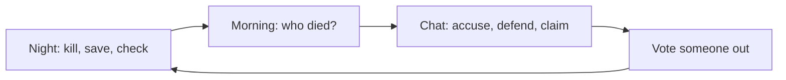
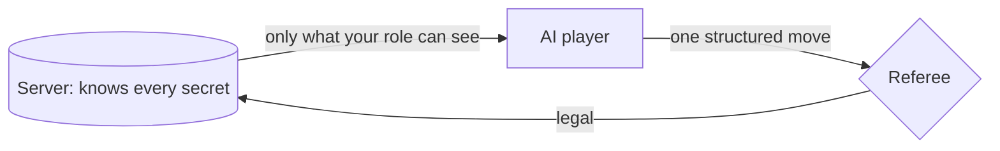

# Kira

**Trust no bot.**

You + 6 AIs. Two of them are mafia and lying to your face. Figure out who before the village runs out of people.

> 🚧 **Status:** Mafia works and is measured in self-play (stats below). More games soon. Not deployed yet.

## 🎲 How a round goes



Repeat until the mafia are gone (village wins) or they catch up to the town (mafia wins).

| Role | How many | What they do |
| --- | --- | --- |
| 🦹‍♂️ Mafia | 2 | Know each other. Kill one player a night |
| 🕵️‍♂️ Detective | 1 | Checks one player a night: mafia or not |
| 👩‍⚕️ Doctor | 1 | Protects one player a night |
| 🕵️ Villager | 3 | Talk, think, vote |

House rules: no kill on night 1, the doctor can't save the same person twice in a row, and roles stay hidden when someone dies.

## 🤖 How the AIs work



- 🔒 **No leaks.** Secrets never reach an AI unless its role should know them.
- 🎭 **Mafia have a plan.** Each day they roll a private strategy: blend in, fake-claim detective, counterclaim, or split their votes.
- 🧾 **Claims are tracked.** The real detective can only claim real results. The mafia can make stuff up, and the game keeps score.
- 🛡️ **Guardrails.** Quotes get fact-checked, and a phrase budget stops everyone saying "convenient" fifty times.
- 🧠 **Model:** GPT-5.6 Luna for everything.

## 📊 Are they any good?

40 full games, all-AI players, 7 per game:

| | |
| --- | --- |
| Village wins | **20 / 40 (50%)** |
| Game length | 2 days: 23, 3 days: 8, 4 days: 8, 5 days: 1 |
| Doctor blocked a kill | 31 / 67 (46%) |
| Mafia fake-claimed detective first | 12 games, 5 never got voted out |
| Moves still illegal after a retry | 0 |
| Cost per game | **$0.016** (about 60 games a dollar) |
| Slowest rounds (p95) | votes and nights 3.96 s, first word 3.40 s |

🧂 **Grain of salt:** 40 games is only good to about ±15 points, the village is AI (not a human), and over half the games end on day 2. We haven't tested if that feels too short.

💡 **Biggest lesson:** hiding roles when someone dies was the lever that mattered. With roles revealed, every fake claim eventually got exposed, and the village won 82%.

## ⚡ Run it

You need [uv](https://docs.astral.sh/uv/) and an OpenAI API key.

```bash
cd backend
cp .env.example .env     # add your OPENAI_API_KEY
uv sync
uv run pytest
uv run python -m server.selfplay --games 5
```

<!-- TODO: add the command that starts the web UI -->

Set a spending limit on your key. 40 games is about $0.64.

## 🗺️ What's next

| Next | |
| --- | --- |
| Lobby, opponent slider, AI cast, hidden personalities, post-game review | soon |
| More hidden-role games on the same engine | after that |
| A link you can just play | eventually |

Full plan and known issues: [docs/design.md](docs/design.md). License: MIT.
